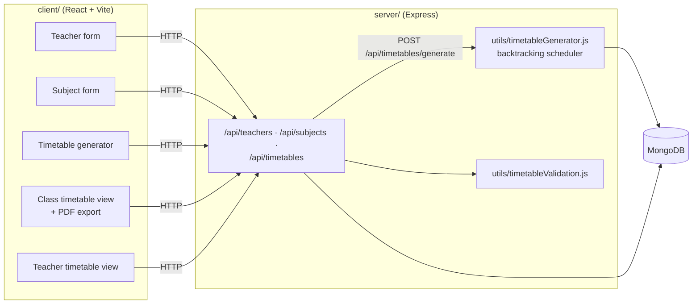

# College Timetable Generator

Builds weekly class timetables for a college automatically. You enter the teachers (with their workload limits and which days they're available) and the subjects for each semester (credits, theory or lab, who can teach them). The generator then fills a Monday to Friday, 7-slot week for a department and section so that no teacher is double-booked, even across other sections' timetables.

Timetables can be viewed per class or per teacher, edited, and exported to PDF.

## How it fits together



## How a timetable is generated

1. **Load** the chosen subjects and their teachers, plus every timetable already saved, so each teacher's existing classes are known.
2. **Sort** subjects by credits (most first), labs before theory. A subject with *n* credits needs *n* slots a week.
3. **Place** each subject by backtracking. A slot is only allowed if these **hard constraints** hold:
   - the slot is free;
   - every teacher of the subject is available that day and not already teaching elsewhere in that slot;
   - labs take two back-to-back slots from the allowed pairs (1–2, 3–4, 5–6, 6–7).
4. **Prefer** better slots using **soft constraints**:
   - avoid the same subject twice in a day;
   - spread each subject evenly across the week;
   - put labs later in the day.
5. **Validate** the result (credit hours met, no clashes) and save it.

## Data model

| Model | Fields |
|---|---|
| Teacher | name, rank (assistant, associate, senior), department, max and current workload, availability per weekday |
| Subject | name, code, credits, semester, department, type (theory or lab), teachers |
| Timetable | semester, department, section, and for each day its 7 slots with subject and teachers |

## API

| Method | Path | Does |
|---|---|---|
| GET / POST | `/api/teachers` | List or add teachers |
| PUT / DELETE | `/api/teachers/:id` | Edit or remove a teacher |
| GET / POST | `/api/subjects` | List or add subjects |
| PUT / DELETE | `/api/subjects/:id` | Edit or remove a subject |
| GET | `/api/subjects/semester/:semester` | Subjects for a semester |
| GET / POST | `/api/timetables` | List or save timetables |
| PUT / DELETE | `/api/timetables/:id` | Edit or remove a timetable |
| POST | `/api/timetables/generate` | Generate and save a timetable for a semester, department and section |
| GET | `/api/timetables/teacher/:teacherId` | One teacher's week across all classes |

## Running it

**Server:**

```bash
cd server
npm install
# server/.env needs MONGODB_URI and PORT
node server.js
```

**Client:**

```bash
cd client
npm install
npm run dev
```

The client's backend address is set as `BACKEND_URL` at the top of the files in `client/src/components/` and points at the hosted server on Render. Change it to `http://localhost:<PORT>` to use a local server.

## Known issues

- `server/.env`, including the MongoDB connection string, is committed to the repository. Remove it from git, add it to `.gitignore`, and change the database password.
- `server/node_modules/` is committed.
- The API has no sign-in, so anyone who can reach it can change the data.

## Tech stack

Node.js · Express · MongoDB · Mongoose · React · Vite · Tailwind CSS · react-to-pdf · react-toastify · Render
